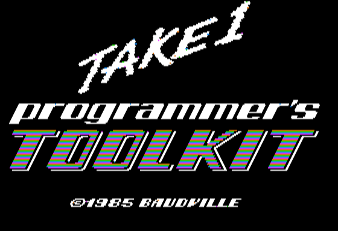
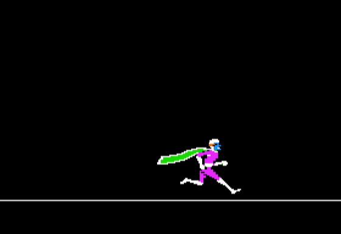
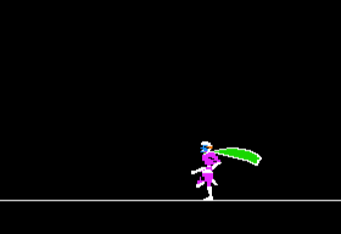

# Take 1 — Apple II Assembly Samples

**English** | [한국어](README.ko.md)

Examples of drawing Take 1 actors and playing scenes on a **64K Apple II with DOS 3.3 or a compatible DOS**.
Includes a ready-to-run sample disk, commented source code, and walkthroughs of both programs.

## Sample disk

**[Download take1-samples.dsk](disk/take1-samples.dsk)** — 140KB, DOS sector order.

Boot the disk to start the **SN scene playback sample** automatically.
When the scene ends, press any key to return to BASIC. Press ESC during playback to stop immediately.

You can also select a sample from BASIC:

```text
RUN HELLO
RUN JOYSTICK CONTROL
```

| Program | What it does | Source and walkthrough |
|---|---|---|
| `HELLO` | Calls the Take 1 engine from assembly to play the logo scene | [SN scene sample](samples/scene/README.md) |
| `JOYSTICK CONTROL` | Runs left or right, keeps running in place when centered, and flips HGR pages 1/2 | [Joystick sample](samples/joystick/README.md) |

Use an Apple II emulator or a real Apple II with 64KB of RAM, including Language Card RAM.
The joystick sample reads the horizontal axis through Apple II paddle 0.

## Screenshots

Captured from the sample disk running in MAME as a 64K Apple IIe.

**SN scene playback** — the final image remains on screen after the logo scene finishes.



| Joystick right | Joystick left |
|---|---|
|  |  |

## Source code

- [SN playback assembly](samples/scene/sn_sample.s) · [BASIC loader](samples/scene/hello.bas)
- [Joystick assembly](samples/joystick/thunder_joystick.s) · [BASIC loader](samples/joystick/joystick_control.bas)
- [Scene API constants](samples/scene/t1scene.inc) · [$6000 memory configuration](samples/ram6000.cfg)

The BASIC loaders load the required files and call the assembly program at `$6000`.
Animation and screen handling run in assembly. Each loader reinstalls the engine it needs,
so you can return to BASIC and switch to the other sample.

## Rights

The newly written sample source code and documentation use the [MIT License](LICENSE).
The original Take 1 engine, sample artwork, scenes, and DOS on the disk remain subject to their respective rights.
**The MIT License does not apply to the entire disk image.** See [NOTICE](NOTICE.md) for the distinction.
